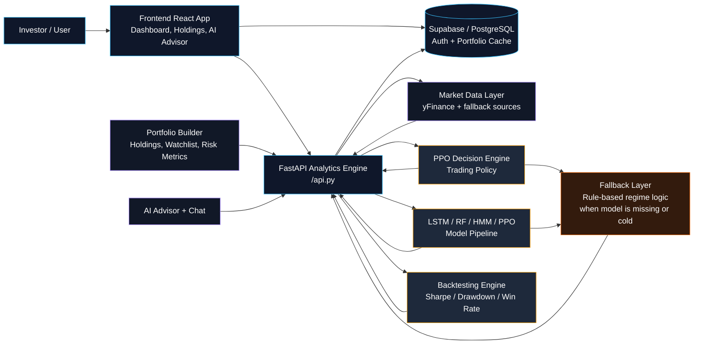

# SmartPortfolio Architecture Diagram

## Runtime flow

1. The user interacts with the React dashboard and holdings screens.
2. The frontend calls the FastAPI analytics backend for quotes, portfolio metrics, signals, and strategy recommendations.
3. The backend fetches live market data from Yahoo Finance, with fallback logic for delayed or partial prices.
4. The model layer runs the ML pipeline (LSTM, Random Forest, HMM, PPO) to derive signals and risk context.
5. If PPO or a model artifact is missing or fails to load, the system falls back to rule-based technical logic using RSI, MACD, and regime state.
6. The decision engine returns a BUY/HOLD/SELL recommendation with confidence and reasoning.
7. The backtesting engine evaluates strategy performance using equity curves, Sharpe ratio, drawdown, and win rate.
8. Results are displayed in the UI as an investor-grade portfolio intelligence dashboard.

## PPO fallback behavior

When PPO is unavailable, the project intentionally does not crash or silently fail. Instead:

- it checks for a saved PPO model
- if the PPO model is missing or fails to load, it sets a fallback reason
- it enters a rule-based fallback path using RF signal + regime detection
- it still produces a valid recommendation with lower confidence

This ensures the app remains usable even when the RL layer is unavailable or incomplete.
